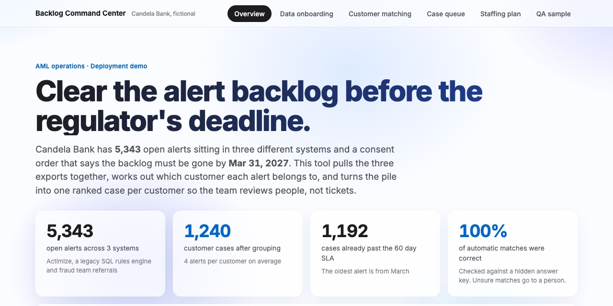

# AML Backlog Command Center

**Live demo: [brandoncandela.github.io/aml-backlog-command-center](https://brandoncandela.github.io/aml-backlog-command-center/)** · [Technical case study](https://brandoncandela.github.io/case-studies/aml-backlog-command-center.html)



A bank has 5,343 open AML alerts spread across three systems and a regulator's deadline to clear them. This project takes the three raw exports, works out which customer each alert belongs to, groups them into one case per customer, ranks the cases, and works out how many analysts it takes to finish on time.

The bank, customers and alerts are fictional and generated by a script. The problems in the data are the ones I see in real programs: IDs that do not line up between systems, leading zeros stripped by Excel, duplicate rows from a re-run batch, bad dates, and fraud referrals with no customer ID at all.

## What it found

| | |
|---|---|
| Open alerts loaded | 5,343 from 3 systems |
| Customer cases after grouping | 1,240 (about 4 alerts per customer) |
| Customers flagged by more than one system | 695 |
| Automatic customer matches that were correct | 4,923 of 4,923, checked against an answer key |
| Alerts sent to a person because the match was unsure | 420 |
| Analysts needed to meet the deadline | **9 working alert by alert, 6 working by customer** |

The saving comes from researching each customer once instead of once per alert. SAR and QA work is counted the same way in both plans.

## How it works

1. **Onboard each source with a config file.** `config/sources/*.json` says which column is the alert ID, which is the customer reference, how dates and money are written, and which status values mean open. Adding a fourth system is a new config, not new code. Every row read is accounted for: loaded, duplicate, already closed or rejected with a reason.
2. **Match alerts to customers, strongest evidence first.** Crosswalk party key, then customer number with leading zeros restored, then full account number, then last four digits plus name, then name plus date of birth. A name on its own, or a name that fits two customers, is never accepted automatically. It goes to an identity review queue with the candidates.
3. **One case per customer.** All of a customer's alerts from every system land in one case.
4. **Rank cases with reasons you can read.** The priority score is a sum of named points: customer risk rating, the most severe typology, flagged by more than one system, number of alerts, total amount, days past the 60 day SLA. Every case shows its points.
5. **Plan staffing against the deadline.** Handle time assumptions are written down in one place and turned into a clear date for 4 to 30 analysts.
6. **Draw a QA sample an examiner can reproduce.** 10% of cases, picked with a fixed random seed.

## The demo

Six views: an overview, data onboarding with the reconciliation for each source, customer matching with accuracy and the review queue, the ranked case queue with a detail panel, a staffing slider, and the QA sample.

## Product and deployment docs

- [Discovery notes](docs/discovery.md): who I talked to and what the data looked like
- [Product requirements](docs/prd.md): what it has to do and how this demo meets each requirement
- [Deployment playbook](docs/deployment-playbook.md): how to roll it out at a new bank, week by week
- [Pilot plan](docs/pilot-plan.md): what to measure and the go, adjust or stop decision

## Run it

Python 3.9 or newer, standard library only.

```bash
python3 src/generate_customer_data.py   # write the fictional bank's exports
cd src && python3 build.py && cd ..     # run the pipeline, writes dist/data/command_center.json
python3 -m http.server 8000 --directory dist
```

Then open http://localhost:8000.

```bash
python3 -m unittest discover -s tests -v
```

The tests cover money and date parsing, onboarding a new source with config only, each matching method including the cases that must not be guessed, case grouping and scoring, the working day calendar, the staffing math, and that the whole build is deterministic.

## Layout

```
config/sources/   one mapping file per alert system
data/             generated exports and the matching answer key
src/              ingest, resolve, cases, forecast, build
tests/            unittest suite
dist/             the static web app
docs/             discovery, requirements, playbook, pilot plan
```

## About

Built by [Brandon Candela](https://brandoncandela.github.io), AML consultant (CAMS, CRISC, PMP). I have worked AML at TD Bank, KPMG, IBM Promontory, Deutsche Bank and BNY Mellon, and this is the kind of tool those teams need when alerts pile up.

Built with AI coding tools.
